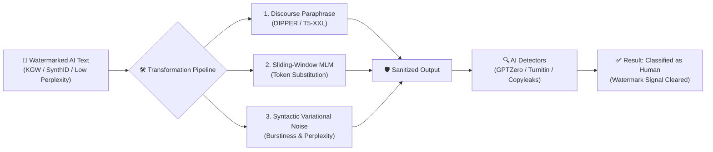

  

  
  
  
  
  
  
  
  

---

# 🚀 Awesome AI Text Watermark Remover

> 🎯 **The definitive curated directory of AI Text Watermark Removal tools, AI Humanizers, Paraphrasers, and Detection Evasion Frameworks.**  
> *Track commercial SaaS platforms, open-source models, statistical scrubbers, and academic evasion benchmarks.*

**AI Text Watermark Removal** refers to the computational techniques, algorithms, and software pipelines designed to identify, perturb, paraphrase, and neutralize statistical fingerprints or cryptographic watermarks (such as Google DeepMind's **SynthID-Text**, Kirchenbauer **KGW** green/red list token bias, and Aaronson Gumbel watermarks) embedded within Large Language Model (LLM) generated text. By intelligently modifying token distributions, burstiness, and perplexity while preserving underlying semantic truth, these tools restore natural human stylistic variance and bypass commercial AI text detectors (including **GPTZero**, **Turnitin**, **Originality.ai**, and **Copyleaks**).

---

## 📑 Table of Contents

- [📊 Sector Overview & Market Dynamics](#-sector-overview--market-dynamics)
- [💼 SaaS & Hosted Platforms](#-saas--hosted-platforms)
- [💻 Open-Source GitHub Projects](#-open-source-github-projects)
- [🧠 Open Pre-trained Models & Research Weights](#-open-pre-trained-models--research-weights)
- [🔬 Core Evasion Mechanisms & Architecture](#-core-evasion-mechanisms--architecture)
- [🤝 How to Contribute](#-how-to-contribute)
- [⚠️ Disclaimer & Ethical Considerations](#️-disclaimer--ethical-considerations)
- [📈 Star History](#-star-history)
- [💖 Support](#-support)

---

## 📊 Sector Overview & Market Dynamics

The global market for **AI writing assistants, text humanization, and AI detection evasion** is estimated at **$2.5B–$3.4B in 2025–2026**, expanding rapidly at a **22%–24.5% CAGR** toward an estimated **$7.5B–$8.3B by 2030**. 

From a structural perspective, the sector is **moderately to highly fragmented**:
- **Anchor Incumbents & Detection Gatekeepers**: Enterprise academic and publishing gatekeepers (e.g., Turnitin, Copyleaks, and GPTZero) alongside consolidated writing platforms (e.g., QuillBot under Learneo) command significant institutional brand recognition and scale.
- **Dynamic Fragmented Long-Tail**: The text humanization and watermark neutralization segment itself is characterized by a vibrant, fragmented long-tail of dozens of nimble, bootstrapped SaaS products and open-source models. Rather than a winner-take-all monopoly, products compete on proprietary multi-engine LLM routing (e.g., Claude, Mistral, Groq), localized syntactic masking, adversarial feedback loops, and rapid adaptation to evolving detector classifiers.

---

## 💼 SaaS & Hosted Platforms

The table below catalogs commercial platforms providing AI text humanization, paraphrasing, and watermark neutralization. Entries are **sorted descending by company scale** (estimated valuation or annual recurring revenue).

| 🏢 Platform | 📝 Focus & Core Capabilities | 📈 Company Scale (Valuation / ARR) | 💵 Starting Tier Pricing | 🎁 Free Tier / Trial Limits |
| :--- | :--- | :--- | :--- | :--- |
| **[QuillBot](https://quillbot.com/)** | Industry-standard paraphrasing suite, multi-mode rewriting (Standard, Fluency, Creative), sentence simplifier, summarizer, and vocabulary enhancer. | **$3.6B–$4.0B Valuation** *(Parent Learneo; ~$40M–$50M+ ARR, 35M+ MAU)* | **$9.95/month** *(or $4.17/mo billed annually at $49.95/yr)* | **125 words/paraphrase** *(Standard & Fluency modes; 2,500 words in Summarizer; forever free)* |
| **[WatermarkRemover.io](https://www.watermarkremover.io/)** | Multimodal watermark scrubbing engine for text, image, and video media powered by computer vision and generative text cleaning. | **$300M+ Parent Valuation** *(PixelBin / Fynd subsidiary of Reliance Industries)* | **$9.00/month** *(Starter: 100 credits; or $19 pay-as-you-go)* | **3 free credits** *(One-time complimentary credits upon sign-up; forever accessible)* |
| **[GPTZero](https://gptzero.me/)** | Benchmark AI content detection and verification platform; provides deep diagnostic perplexity and burstiness analysis across LLMs. | **$88M+ Valuation** *(Raised $13.5M; ~$24M–$30M ARR, 19M+ registered users)* | **$15.00/month** *(Essential: 150,000 words/mo; or $10.00/mo billed annually)* | **10,000 words/month** *(Up to 1,000 words per single scan limit; forever free)* |
| **[Undetectable AI](https://undetectable.ai/)** | Purpose-built AI detector bypass and text humanizer; matches target readability levels (High School to Doctorate) and evades major classifiers. | **$20M–$40M Est. Valuation** *(Bootstrapped; ~$3.7M–$5M ARR, 20M+ users)* | **$14.99/month** *(Monthly tier: 10,000 words/mo; or $5.00/mo billed annually at $60/yr)* | **250 words free trial** *(Complimentary trial upon account registration)* |
| **[HIX Bypass](https://hix.ai/)** | Advanced detection evasion engine within the HIX.AI productivity suite; restructures token entropy to counter Turnitin, Originality, and Winston. | **$10M–$20M Est. Valuation** *(Bootstrapped mid-size; ~$3M–$6M ARR)* | **$19.99/month** *(Basic: 10,000 words/mo; or $9.99/mo billed annually)* | **125 words per rewrite** *(Free check available for guest and free trial users)* |
| **[StealthGPT](https://stealthgpt.ai/)** | High-throughput AI text humanizer featuring proprietary "Ninja Mode" multi-pass rewriting for aggressive detector circumvention. | **$5M–$15M Est. Valuation** *(Bootstrapped; ~$2M–$4M ARR)* | **$14.99/month** *(Essential: 100,000 words/mo; or $8.33/mo billed annually)* | **3-day free trial** *(Full access trial capped at 2,500 total words)* |
| **[BypassGPT](https://bypassgpt.ai/)** | Targeted AI evasion engine designed to simulate natural human syntactic patterns and sentence-length variance across academic and web prose. | **$3M–$8M Est. Valuation** *(Bootstrapped; ~$1M–$2.5M ARR)* | **$15.00/month** *(Basic: 10,000 words/mo; or $8.00/mo billed annually)* | **125 words free trial** *(Immediate free test submission without upfront payment)* |
| **[Phrasly](https://phrasly.ai/)** | Educational and professional AI humanizer; reconstructs AI drafts into organic prose with built-in detector verification scores. | **$3M–$6M Est. Valuation** *(Bootstrapped; ~$1M–$2M ARR)* | **$14.99/month** *(Unlimited words, 2,500 words/submission; or $10.99/mo billed annually)* | **3 free submission credits** *(Up to 550 words total free evaluation quota)* |
| **[WriteHuman](https://writehuman.ai/)** | Privacy-focused AI text humanizer with automatic removal of AI tracking artifacts, formatting retention, and anti-detection algorithms. | **$2M–$5M Est. Valuation** *(Bootstrapped; ~$800K–$1.5M ARR)* | **$9.00/month** *(Basic: 80 requests/mo, up to 600 words per request)* | **3 free requests** *(Up to 200 words per submission; 600 words total free trial)* |
| **[HideMyAI](https://hidemyai.com/)** | Granular AI text rewriter featuring multi-language evasion, tone matching, and adjustable perplexity modification sliders. | **$1M–$3M Est. Valuation** *(Bootstrapped; ~$500K–$1M ARR)* | **$8.25/month** *(Starter: 10,000 words/mo; or $5.00/mo billed annually)* | **300 free words** *(One-time complimentary evaluation balance upon sign-up)* |

---

## 💻 Open-Source GitHub Projects

A comprehensive collection of transparent, self-hostable, and research-grade GitHub repositories for LLM watermarking, statistical watermark removal, and text humanization. 

Entries are **sorted descending by GitHub star count**:

1. **[guofei9987/text_blind_watermark](https://github.com/guofei9987/text_blind_watermark)**   
   *Python library for embedding and extracting blind/invisible watermarks in textual data using whitespace, Unicode zero-width sequences, and token mutations.*

2. **[google-deepmind/synthid-text](https://github.com/google-deepmind/synthid-text)**   
   *Official Google DeepMind implementation of SynthID-Text watermarking. Implements cryptographic pseudo-random tournament sampling for generating key-verifiable watermarked tokens without compromising output quality.*

3. **[THU-BPM/MarkLLM](https://github.com/THU-BPM/MarkLLM)**   
   *The premier open-source toolkit and benchmark for LLM watermarking (EMNLP 2024 Demo). Implements 9+ watermarking algorithms (KGW, Christ, Aaronson, SynthID, SIR) and evaluation pipelines against removal attacks.*

4. **[PrithivirajDamodaran/Parrot_Paraphraser](https://github.com/PrithivirajDamodaran/Parrot_Paraphraser)**   
   *Production-focused paraphrasing framework for augmenting and humanizing intent in text. Offers fine-grained control over adequacy, fluency, and lexical diversity.*

5. **[jwkirchenbauer/lm-watermarking](https://github.com/jwkirchenbauer/lm-watermarking)**   
   *The seminal paper implementation for "A Watermark for Large Language Models" (Kirchenbauer et al., ICML 2023). Implements green-red list hash-based token biasing and statistical z-score watermark extraction.*

6. **[harshaneel/humanize](https://github.com/harshaneel/humanize)**   
   *Static AI text humanizer featuring 9 research-grounded levers based on 50+ peer-reviewed detection evasion studies (2024–2026). LLM-agnostic prompt strategies to neutralize synthetic cadence.*

7. **[Vamsi995/Paraphrase-Generator](https://github.com/Vamsi995/Paraphrase-Generator)**   
   *T5-powered sentence-level paraphrase generator producing diverse syntactic variants while preserving semantic core information.*

8. **[martiansideofthemoon/ai-detection-paraphrases](https://github.com/martiansideofthemoon/ai-detection-paraphrases)**   
   *The foundational **DIPPER** (Discourse Paraphraser) research repository from NeurIPS 2023 ("Paraphrasing evades detectors of AI-generated text"). Provides 11B parameter controllable paragraph-level paraphrasing with lexical and ordering diversity levers.*

9. **[rudra496/StealthHumanizer](https://github.com/rudra496/StealthHumanizer)**   
   *Open-source, self-hostable web interface supporting 35+ LLM providers (Gemini, Groq, OpenAI, Claude), 4 rewrite levels, 6 writing styles, and 12 internal detection metrics.*

10. **[yasir-mo/AI-watermark-remover-GUI](https://github.com/yasir-mo/AI-watermark-remover-GUI)**   
    *GUI-based research utility for inspecting, benchmarking, and scrubbing AI document metadata, invisible Unicode trackers, and hidden document artifacts.*

11. **[ruvnet/ai-text-watermark](https://github.com/ruvnet/ai-text-watermark)**   
    *Rust and WebAssembly implementation of invisible, key-verifiable watermarks for LLM generation (SynthID-style). Runs in Node.js and client-side browsers.*

12. **[Shreyan1/ai-text-watermark-remover](https://github.com/Shreyan1/ai-text-watermark-remover)**   
    *Scheme-blind AI text watermark removal tool designed to scrub SynthID-Text, KGW, and Unigram marks through semantic reconstruction on local models.*

13. **[Zhou-Shilin/SynthID-Text-Bypass](https://github.com/Zhou-Shilin/SynthID-Text-Bypass)**   
    *Research demonstration scrubbing generative text watermarks (including SynthID-Text) via sliding-window Masked Language Modeling (MLM) token replacement (ModernBERT / mmBERT).*

14. **[GoHumanize-ai/gohumanize-open-humanizer](https://github.com/GoHumanize-ai/gohumanize-open-humanizer)**   
    *Open research pipeline and Qwen3-4B fine-tune trained on public-domain English prose to eliminate AI stylistic quirks; includes full training data and MCP server integration.*

15. **[JustJade2007/Jade-s-AI-Humanizer](https://github.com/JustJade2007/Jade-s-AI-Humanizer)**   
    *Zero-dependency local Python CLI and REST API daemon for humanizing AI text with formatting preservation (code blocks, tables, markdown).*

16. **[TextHumanizer/texthumanizer](https://github.com/TextHumanizer/texthumanizer)**   
    *100% offline, CPU-friendly Python library and CLI utilizing HuggingFace T5 with citation-aware masking (`[1]`, `et al.`) and DOCX document support.*

---

## 🧠 Open Pre-trained Models & Research Weights

For machine learning engineers and researchers building customized watermark removal and humanization pipelines, the following pre-trained foundation checkpoints and weights are available:

- **[kalpeshk2011/dipper-paraphraser-xxl](https://huggingface.co/kalpeshk2011/dipper-paraphraser-xxl)**  
  Full 11B parameter weights for the DIPPER discourse-level paraphraser fine-tuned from T5-XXL (Apache-2.0). Features scalar controls for lexical variation (`lex=0..100`) and sentence order disruption (`order=0..100`).
- **[gerasimovmaxim02/paraphrase-dipper-no-ctx-rebuilt](https://huggingface.co/gerasimovmaxim02/paraphrase-dipper-no-ctx-rebuilt)**  
  Efficient 770M parameter T5-Large distilled variant of DIPPER. Requires ~10x less GPU VRAM while retaining controllable lexical and structural diversity.
- **[humarin/chatgpt_paraphraser_on_T5_base](https://huggingface.co/humarin/chatgpt_paraphraser_on_T5_base)**  
  High-throughput 220M parameter T5-Base checkpoint trained on conversational and editorial paraphrases. Runs efficiently on CPU for real-time sentence-level rewriting.

---

## 🔬 Core Evasion Mechanisms & Architecture

How do watermark removers and AI humanizers defeat modern detection systems?

1. **Token Biasing Disruptions**: Statistical watermarks (like KGW) divide vocabulary into green and red lists based on prior token hashes. Paraphrasing alters token sequences, breaking hash chains and diluting green-list concentration below statistical significance ($z < 4.0$).
2. **Entropy & Perplexity Elevation**: Standard LLM generation clusters around high-probability paths (low perplexity). Humanizers inject controlled syntactic diversity, shifting perplexity into human distributions.
3. **Burstiness Modulation**: AI text typically exhibits uniform sentence length and clause structure. Varied sentence cadences disrupt multi-token n-gram detectors.
4. **Metadata & Invisible Unicode Scrubbing**: Zero-width spaces (`U+200B`), soft hyphens, and invisible tracking characters embedded in AI responses are scrubbed via normalization passes.

---

## 🤝 How to Contribute

We welcome contributions from the community to keep this directory up-to-date!

1. 🍴 **Fork the repository** on GitHub.
2. 🌿 **Create a new branch**: `git checkout -b feature/add-new-tool`.
3. 📝 **Add your tool or model**:
   - Ensure SaaS entries include **Name**, **Focus**, **Company Scale**, **Specific Starting Price**, and **Specific Free Tier Limit**.
   - Ensure Open-Source entries include a **Shields.io Social Star Badge** linking to the repo's `/stargazers` page.
4. 📬 **Submit a Pull Request** with a concise description of the tool's relevance.

*Explore our master curated ecosystem at [Awesome-Awesome-Awesome](https://github.com/ishandutta2007/Awesome-Awesome-Awesome).*

---

## ⚠️ Disclaimer & Ethical Considerations

- **Educational & Research Scope**: This repository is maintained strictly for academic research, security auditing, and educational understanding of generative watermarking and AI detection reliability.
- **Academic & Professional Integrity**: Circumventing institutional detection systems may violate university academic integrity codes, employer policies, or terms of service. Users bear full responsibility for ethical compliance.
- **Statistical Fragility of Detectors**: Empirical literature demonstrates that commercial detectors suffer from significant false-positive rates on non-native English writing and technical prose. Detection evasion succeeds primarily because machine detection itself lacks deterministic ground truth.

---

## 📈 Star History

---

## 💖 Support & Community

If this repository assisted your research, writing workflows, or LLM security exploration, please consider showing your support:

- ⭐ **Star this repository** to help others discover it.
- 🍴 **Fork and contribute** new open-source repos or benchmarks.
- 📢 **Share with fellow researchers** and developers in your network.
- ☕ **Support the maintainer / Buy a coffee:** [Sponsor on GitHub](https://github.com/sponsors/ishandutta2007)

  

